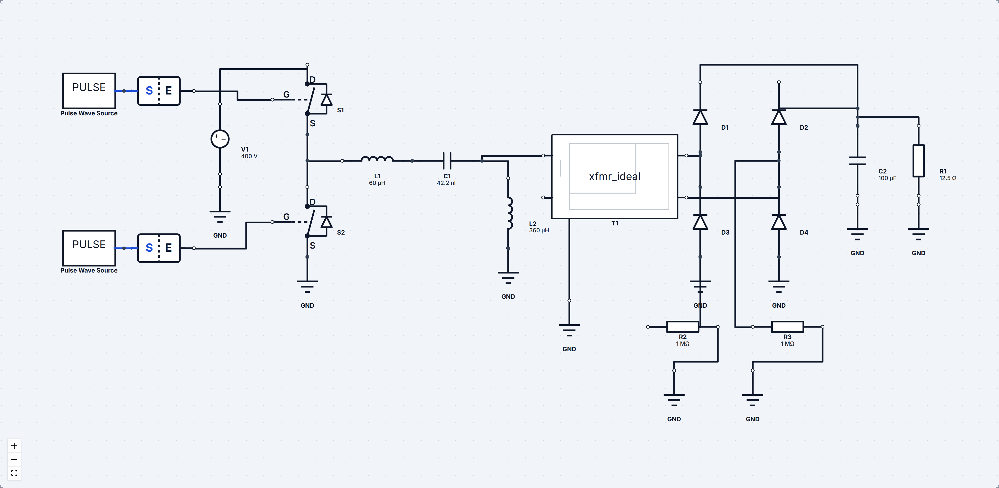
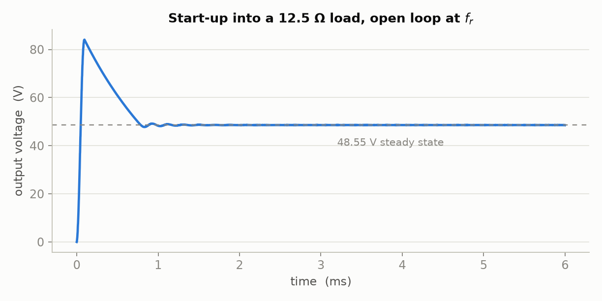
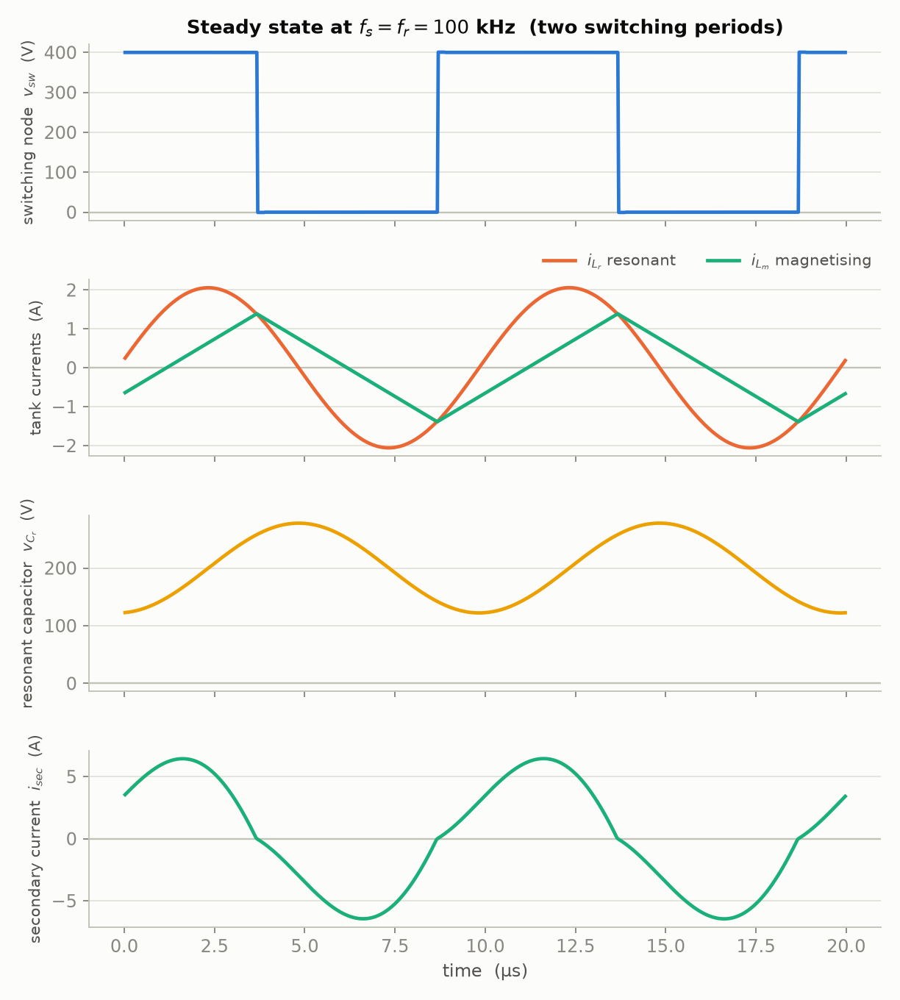
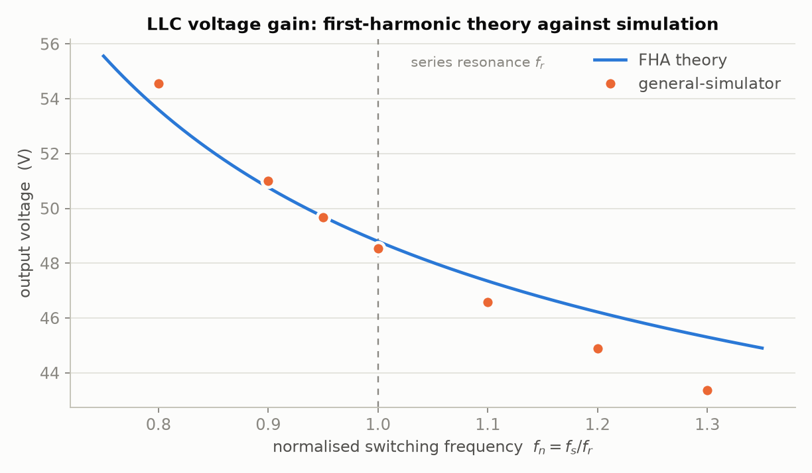

# Simulating an LLC resonant converter from zero

This is a complete walk-through for somebody who has never opened General
Simulator. By the end you will have an LLC half-bridge running, you will know
where its gain curve comes from, and you will have checked the simulator's
answer against the analytical one — including the places where the two
disagree, which turn out to be the interesting places.

Every number in this article was measured from a real run. Nothing is quoted
from a datasheet or a textbook table.

---

## 1. Before you start

### 1.1 What the pieces are

The tool is not one program. Knowing the split makes the settings obvious:

| Piece | What it does |
|---|---|
| **The VS Code extension** | hosts the schematic editor and launches everything else |
| **The compiler** (`gsim-core`) | turns your schematic into a netlist; it also *publishes the component catalogue* the editor draws from |
| **The simulator** (`general-simulator`) | solves the netlist and streams the waveforms back |

You draw. The compiler translates. The simulator solves. The results come back
to the editor to be plotted. The editor never decides what a component *is* —
the engine declares that, and the editor displays it faithfully.

### 1.2 Install the two pieces

Neither piece needs a build toolchain: both are published as downloads, one
file each.

**The editor.** Take `general-simulator-gui.vsix` from the
[editor releases](https://github.com/GLODI-Engineering/general-simulator-gui-for-vscode/releases/latest)
and install it:

```bash
code --install-extension general-simulator-gui.vsix
```

**The engine.** Take the archive for your machine from the
[simulator releases](https://github.com/GLODI-Engineering/general-simulator/releases/latest):

| Your machine | Archive |
|---|---|
| Linux, Intel or AMD | `general-simulator-linux-x86_64.tar.gz` |
| Linux, ARM | `general-simulator-linux-aarch64.tar.gz` |
| macOS, Apple silicon | `general-simulator-macos-aarch64.tar.gz` |
| Windows | `general-simulator-windows-x86_64.zip` |

Unpack it wherever you keep tools and note the path to the `general-simulator`
binary inside it — `general-simulator.exe` on Windows. That path is the one
thing the next step cannot guess.

<details>
<summary>Building from source instead</summary>

If you would rather build it, the engine is a Rust workspace:

```bash
git clone https://github.com/GLODI-Engineering/general-simulator
cd general-simulator
cargo build --release -p general-simulator-cli
```

The binary is then at `target/release/general-simulator` inside that checkout,
and the editor is built with `pnpm install && pnpm package` in its own
checkout. Everything after this section is identical either way.

</details>

### 1.3 Point the extension at the engine

Open your settings (`Ctrl+,`, or `Cmd+,` on a Mac) and search for
`generalSimulator`. The only setting you must fill in is the path to the
solver binary.

It is usually faster to edit the JSON directly. Open the command palette
(`Ctrl+Shift+P`) → **Preferences: Open User Settings (JSON)** → add:

```jsonc
{
  // The binary that actually runs a simulation. This is the one setting
  // you cannot skip.
  "generalSimulator.generalSimulatorPath": "/path/to/general-simulator",

  // The checkout that holds pyproject.toml. Leave empty and the extension
  // looks for it next to the open workspace.
  "generalSimulator.workspaceRoot": "",

  // How the kernel sidecar is launched. 'uv' is the default and needs no
  // further setup.
  "generalSimulator.pythonRunner": "uv",

  // Start the kernel when the extension wakes up, so Run works immediately.
  "generalSimulator.autoStartKernel": true
}
```

That path is the binary you unpacked in §1.2 — the file itself, not the
folder holding it.

**How to tell it worked.** Open any `.gsim_sch` and press Run. If the path is
wrong you get a named error — `SolverUnavailable`, with the message saying the
binary was not found — not a silent hang. That distinction matters: a
misconfigured path should accuse itself.

> **A note on the settings list.** You will see entries for Octave and for
> extra `PYTHONPATH` directories. Those are for `octfunc` and `pyblock`
> scripted blocks and are not needed here. If you are reading an older
> write-up that mentions `ngspicePath` or `xycePath`, those settings are gone:
> the project targets one backend now.

---

## 2. What an LLC is, and why anyone bothers

A conventional hard-switched converter turns its transistors on while they are
holding voltage. The energy stored in the device capacitance is dumped as heat
every single cycle, and that loss grows linearly with switching frequency. It
is the wall you hit when you try to make a converter smaller, because smaller
magnetics means a higher frequency.

The LLC's trick is to put a resonant tank between the switches and the load, and
operate it so the tank current is *lagging* — still flowing in the direction
that discharges the switching node — at the instant a transistor turns on. The
node is already at the rail, so the device turns on across zero volts. That is
**zero-voltage switching (ZVS)**, and it removes the loss term that set the
frequency ceiling.

The name is the component list: two inductors and a capacitor, $L_r$, $L_m$ and
$C_r$.

### 2.1 The circuit

A half-bridge chops the DC bus into a square wave. That square wave drives a
series $L_r$–$C_r$ pair, and the transformer's magnetising inductance $L_m$ sits
across the primary. The secondary is rectified into the output capacitor.

$L_m$ is not a parasitic here. It is a design parameter, deliberately made small
enough to carry a useful circulating current — that circulating current is what
guarantees ZVS at light load, when the load current alone would not be enough to
commutate the node.

### 2.2 Two resonances, not one

Because $L_m$ is in the circuit, the tank has two natural frequencies, and the
whole behaviour of the converter follows from which one you are near.

When the output is conducting, the rectifier clamps the transformer primary, so
$L_m$ is held at a fixed voltage and takes no part in the resonance. Only $L_r$
and $C_r$ ring:

$$f_r = \frac{1}{2\pi\sqrt{L_r C_r}}$$

When the output stops conducting — which happens below $f_r$, once the resonant
current has fallen back to the magnetising current — the rectifier is open and
$L_m$ joins the tank in series:

$$f_{r2} = \frac{1}{2\pi\sqrt{(L_r + L_m)\,C_r}}$$

$f_{r2}$ is always the lower of the two. The converter lives between them and
above, and its gain depends on where in that range it sits.

### 2.3 The design used here

| Quantity | Symbol | Value |
|---|---|---|
| Input bus | $V_{in}$ | 400 V |
| Resonant inductor | $L_r$ | 60 µH |
| Resonant capacitor | $C_r$ | 42.2 nF |
| Magnetising inductance | $L_m$ | 360 µH |
| Turns ratio | $n$ | 4 : 1 |
| Load | $R_L$ | 12.5 Ω |
| Output capacitor | $C_o$ | 100 µF |

From which:

$$f_r = \frac{1}{2\pi\sqrt{60\,\mu\text{H} \cdot 42.2\,\text{nF}}} = 100.0\ \text{kHz}
\qquad
f_{r2} = 37.8\ \text{kHz}$$

$$Z_r = \sqrt{\frac{L_r}{C_r}} = 37.7\ \Omega
\qquad
m = \frac{L_m}{L_r} = 6$$

---

## 3. Deriving the control law

### 3.1 The idea: replace the square wave with its first harmonic

The LLC has no closed-form time-domain solution worth carrying around. The
standard approach is **First Harmonic Approximation (FHA)**: assume the tank is
selective enough that only the fundamental matters, and solve the resulting
linear circuit with ordinary phasors.

It is an approximation, and knowing *where* it is wrong is most of the point of
this article.

A half-bridge driven at 50% duty produces a square wave between $0$ and
$V_{in}$. Its fundamental, referred to the half-bridge midpoint, has amplitude

$$V_{1,\text{pk}} = \frac{2}{\pi}\cdot\frac{V_{in}}{2}$$

### 3.2 Folding the rectifier into a resistor

The rectifier and load are not linear, but across one cycle they absorb a
nearly square current at a nearly square voltage. Equating the fundamental
power gives the **AC equivalent resistance** seen at the primary:

$$R_{ac} = \frac{8}{\pi^2}\, n^2 R_L$$

For our numbers, $R_{ac} = \frac{8}{\pi^2}\cdot 16 \cdot 12.5 = 162.1\ \Omega$.

The $8/\pi^2$ carries two factors that happen to combine: $2/\pi$ from the
square-wave fundamental and another $2/\pi$ from the rectifier, squared because
power goes as voltage times current.

### 3.3 The tank as a divider

Now the tank is a linear two-port. Write the series arm and the parallel arm:

$$Z_s(\omega) = j\omega L_r + \frac{1}{j\omega C_r}
\qquad
Z_p(\omega) = \frac{j\omega L_m \cdot R_{ac}}{j\omega L_m + R_{ac}}$$

and the voltage gain of the tank is just the divider ratio:

$$M(\omega) = \left|\frac{Z_p}{Z_s + Z_p}\right|$$

The output voltage follows by dividing by the turns ratio:

$$\boxed{\;V_o = M(\omega)\cdot\frac{V_{in}}{2}\cdot\frac{1}{n}\;}$$

### 3.4 Reading the law

Define the quality factor and the normalised frequency:

$$Q = \frac{Z_r}{R_{ac}} = \frac{37.7}{162.1} = 0.233
\qquad
f_n = \frac{f_s}{f_r}$$

Three facts fall out, and they are the whole control strategy:

1. **At $f_n = 1$, $Z_s = 0$** — the series arm is a short, $M = 1$ exactly,
   and the gain is independent of load. The converter is at its design point
   and $V_o = \tfrac{V_{in}}{2n}$.
2. **Below $f_n = 1$, $M > 1$.** The series arm is capacitive, partially
   cancelling $Z_p$. This is the boost region, and it is where an LLC rides out
   a brown-out on the input.
3. **Above $f_n = 1$, $M < 1$,** falling monotonically. The series arm is
   inductive and divides the drive down.

So the control variable is **frequency, not duty cycle**. Duty stays at 50%
forever. To raise the output you *lower* the frequency; to lower it you raise
the frequency. The plant gain $\partial V_o/\partial f_s$ is **negative**, which
is the single most important sign in the loop — a controller written as if it
were a buck will run away.

That gain is also strongly non-linear: it is nearly flat just above resonance
and becomes very steep as you approach the peak below resonance. Any practical
voltage loop closes around this with a compensator whose bandwidth must respect
the steepest part of the curve it will visit.

---

## 4. Building it in General Simulator



The schematic file is [`llc-converter.gsim_sch`](./assets/llc-converter.gsim_sch) —
open it directly if you would rather read than rebuild.

Working left to right:

**Gate drive.** Two `Pulse Wave Source` blocks, complementary, each feeding a
signal-to-physical converter (`S|E`) that drives a switch gate. This is worth
noticing: the pulse sources live in the **signal** domain, the switches in the
**physical** domain, and the converter block is the explicit, visible boundary
between them. Nothing is implicit. The same shape is how you would attach a C
or Python control block later — the controller emits a signal, a converter
turns it into something the circuit can be driven by.

**Half bridge.** `S1` and `S2`, ideal switches, 50% duty with 2% dead time. The
gate is a *block reference*, not a node voltage, so there is no bootstrap
supply to model for the high-side device. For an ideal switch that is the right
abstraction — the question "is it on?" has a definite answer without needing a
floating gate supply.

**The tank.** `L1` = $L_r$ = 60 µH and `C1` = $C_r$ = 42.2 nF in series, `L2` =
$L_m$ = 360 µH across the primary.

**The transformer — one block, from the library.** General Simulator has no
transformer *element*, and it does not need one. An ideal transformer is a
`.SUBCKT` holding the three parts it has always been built from:

- a **VCVS** (gain $1/n$) senses the primary voltage and imposes
  $V_{sec} = V_{pri}/n$;
- a **0 V source** in series with the secondary acts as a current sensor;
- a **CCCS** (gain $1/n$) reflects that current back as $I_{pri} = I_{sec}/n$.

Defined once, it is placed as the single block `T1` with four terminals —
`p1`, `p2`, `s1`, `s2` — and every schematic that needs a transformer uses it
instead of re-drawing the trio. That is what the library is for.

Before trusting it inside a resonant converter I checked it alone: 100 V in,
4:1, into 10 Ω gave 25.0000 V and 2.500 A on the secondary, 0.625 A on the
primary, and 62.5 W on both sides. Exact. Then the same subcircuit inside the
LLC reproduced the inline version's output to the millivolt. It is worth
building the sub-block you are unsure of and testing it by itself before it is
buried in something oscillating at 100 kHz.

> This did not work until recently. A current-controlled source names its
> controlling voltage source, and that name is scoped to the subcircuit it is
> written in. Flattening renamed the source but not the reference, so the build
> failed with `unknown controlling branch 'VS'` — which is exactly the
> reference an ideal transformer needs. Fixed in `general-mna`; see §7.

**Rectifier and output.** `D1`–`D4` as a full bridge, drawn as two legs — the
way a bridge is read, not as four diodes in a column. `C2` = 100 µF, `R1` =
12.5 Ω.

The two 1 MΩ resistors (`R2`, `R3`) are bleeders that give the floating
secondary a defined potential during the interval when every diode is off. I
expected them to be unnecessary, since an ideal diode's off-state conductance
is $10^{-9}$ S rather than zero, and tested it: without them the output comes
out at 43.4 V with 25 V of ripple instead of 48.5 V with 0.12 V. They are
needed.

**A word on grounds.** Every return here goes to its own ground symbol rather
than to one shared symbol across the sheet. With a single ground every return
is a separate wire to the same point, and the router draws them as a ribbon of
parallel lines across the middle of the drawing. Local ground symbols are both
how schematics are drawn and how this one became readable.

---

## 5. What the simulator says

### 5.1 Start-up



Open loop at exactly $f_r$, the output rises to **48.55 V** with no overshoot
worth naming, settling in about 3 ms — roughly two output time constants
($R_L C_o = 1.25$ ms), which is what a well-damped first-order output filter
should do.

The analytical prediction is $\tfrac{V_{in}}{2n} - 2V_d = 200/4 - 1.2 = 48.80$ V,
taking the two conducting diode drops into account. The simulator lands
**0.5% low**, and that gap is real: the switch on-resistance and the finite
on-state conductance of the ideal diode model both cost a little.

### 5.2 Steady state at resonance



This figure is the LLC's signature, and every feature in it is diagnostic:

- **The switching node** is a clean 0–400 V square wave.
- **The resonant current $i_{L_r}$ is sinusoidal.** At $f_n = 1$ the tank is
  driven exactly at its own natural frequency, so the current it draws is the
  pure tone it most wants to pass.
- **The magnetising current $i_{L_m}$ is triangular.** $L_m$ sees the
  rectifier-clamped primary voltage, which is square, and the integral of a
  square wave is a triangle. Measured peak **1.387 A** against the analytical
  $\frac{n V_o}{4 L_m f_s} = 1.347$ A — within 3%.
- **The two curves touch exactly at the peaks.** This is the part worth
  pausing on. When $i_{L_r} = i_{L_m}$, no current is left over to reach the
  secondary, so the rectifier stops conducting. That tangency *is* the boundary
  of the conduction interval, and you can read it straight off the plot.
- **The secondary current** confirms it: each half-cycle is a rectified
  sinusoid that reaches zero precisely where the two tank currents meet.

### 5.3 Zero-voltage switching

ZVS is a statement about the sign of the tank current at a specific instant.
Sampling $i_{L_r}$ at each high-side turn-on:

```
t = 5.5089 ms   i_Lr = -1.178 A   ZVS
t = 5.5189 ms   i_Lr = -1.178 A   ZVS
t = 5.5289 ms   i_Lr = -1.178 A   ZVS
```

Negative, so the current is flowing in the direction that discharges the
switching node before the device closes. The converter is in ZVS, which is the
entire reason to choose this topology.

### 5.4 The gain curve against theory

The real test. Sweeping the switching frequency and comparing each steady-state
output against the FHA prediction from §3:



| $f_n$ | $f_s$ (kHz) | $M_{FHA}$ | $V_o$ predicted | $V_o$ simulated | error |
|---|---|---|---|---|---|
| 0.80 | 80.0 | 1.0962 | 53.61 V | 54.56 V | **+1.77%** |
| 0.90 | 90.0 | 1.0393 | 50.77 V | 51.01 V | +0.48% |
| 0.95 | 95.0 | 1.0180 | 49.70 V | 49.67 V | −0.06% |
| 1.00 | 100.0 | 1.0000 | 48.80 V | 48.55 V | −0.52% |
| 1.10 | 110.0 | 0.9710 | 47.35 V | 46.58 V | −1.62% |
| 1.20 | 120.0 | 0.9484 | 46.22 V | 44.89 V | −2.88% |
| 1.30 | 130.0 | 0.9301 | 45.31 V | 43.36 V | **−4.30%** |

The three qualitative predictions of §3.4 all hold: gain above unity below
resonance, exactly unity at resonance, monotonically falling above.

---

## 6. Where they disagree — and which one is wrong

The error column is not noise. It is **smallest at resonance (0.06%) and grows
in both directions**, reaching −4.3% at $f_n = 1.3$. That is a signature, not
scatter, and it is worth being precise about what it means.

**The simulator is right and the theory is approximate.** FHA's one assumption
is that only the fundamental matters. That assumption is strongest exactly
where the tank is most selective — at resonance, where §5.2 shows the resonant
current is genuinely a clean sinusoid. Away from resonance the current stops
being sinusoidal: the conduction intervals shorten, the harmonics the tank
passes stop being negligible, and the fundamental-only bookkeeping over-counts
the power transferred. So FHA over-predicts gain above resonance, which is
precisely the sign observed.

This is the textbook limitation of FHA, reproduced from first principles by a
simulation that was told nothing about it. Two independent methods agreeing to
0.06% where both are valid, and diverging in the direction and magnitude theory
predicts for itself where one is not, is a much stronger result than agreement
everywhere would have been. Agreement everywhere would have suggested the
simulator had FHA baked into it.

**The practical consequence:** size an LLC with FHA near resonance and you will
be within a fraction of a percent. Use it to predict the gain at $f_n = 1.3$ and
you will be several percent optimistic — which, in a design where that
frequency is the one holding the output up at minimum input voltage, is the
difference between a converter that regulates and one that does not.

### 6.1 Cross-checking the measurements themselves

One more guard. Every number above was computed in Python from the returned
waveforms — so the measurement code is an unverified link in the chain.
General Simulator can also compute measurements itself, inside the engine, with
`kind=measure` lines in the netlist. Running both on the *same* solve:

| Measurement | `kind=measure` | Python | difference |
|---|---|---|---|
| mean $V_o$ | 48.594533408 | 48.594533408 | 0.00000% |
| $V_o$ peak-to-peak | 0.124579406 | 0.124579406 | 0.00000% |
| $i_{L_r}$ RMS | 1.453229426 | 1.453306118 | 0.00528% |
| $i_{L_r}$ max | 2.088627800 | 2.088627800 | 0.00000% |

Three identical to nine significant figures; the RMS differs in the fifth
decimal because the two use different quadrature rules on the same samples. The
post-processing is not inventing anything.

---

## 7. What this exercise turned up

Writing this article was also a test of the tool. Seven things surfaced that
were not known before, listed here because a tutorial that claims everything
was perfect is not worth reading. Five are fixed; two are not.

**Fixed:**

1. **A current-controlled source lost its controlling branch across a
   subcircuit boundary.** An `F`/`H` card names the voltage source whose
   current controls it, and that name is scoped to the body it is written in.
   Flattening prefixed every element name with the instance path but left the
   reference alone, so `F1 p1 p2 VS 0.25` survived expansion still pointing at
   `VS` while the source had become `X1.VS`, and the build failed with
   `unknown controlling branch 'VS'`. This is precisely the reference an ideal
   transformer needs, so until it was fixed a transformer could not be a
   library component at all.
2. **A tapped wire could not be simulated.** The editor splices a
   `routing.junction` block in when a branch is landed on an existing
   conductor — the ordinary way anyone draws a node with three or more wires.
   The compile registry had no entry for it, so every schematic drawn that way
   failed on Run with `unknown-type`. Registered as structural: it emits no
   card, and the conductors meeting at it share a node.
3. **Four components declared ports no artwork could reach.** Both
   current-controlled sources put `p` and `n` on the *same* face at its two
   corners; the comparator carried the op-amp's offsets into a shorter box, so
   its inverting input sat outside the triangle; the MESFET put drain and
   source on a far corner. They drew as circles floating beside the symbol with
   nothing joining them. The catalogue generator now rejects any port within
   two units of a face corner.
4. **A dependent source drew a lead outside its own box.** The current-sense
   arrow ran from y=66 to y=80 in a 60-tall footprint, colliding with the value
   label and implying a connection the component does not have.
5. **No ideal transformer.** Now a library `.SUBCKT`, placed as one block.

**Not fixed:**

6. **`auto_arrange` is not presentable.** Laying this circuit out
   automatically produced a topologically correct schematic with long crossing
   wires and scattered parts — unusable as a figure. The layout in §4 is
   hand-placed. Automatic layout needs work for circuits with heavy ground
   fan-out.
7. **Declared parameter defaults are not optional.** The catalogue gives every
   parameter a default, but the compiler rejects a block that omits one
   (`missing-param: block 'S1' is missing required parameter 'g_breakdown'`).
   The editor fills them in when you drop a component, so this only bites
   generated or hand-edited files — but a declared default that cannot be
   relied on is a sharp edge.

None of these touched the numerical result. The solver matched closed-form
theory to 0.06% where that theory is valid, and the engine's own measurement
pass agreed with independent post-processing to nine figures.

## 8. Where to go next

- **Close the loop.** Everything here is open loop. The sign of
  $\partial V_o / \partial f_s$ is negative and the gain is strongly
  non-linear, so a fixed-gain PI tuned at resonance will behave very
  differently at $f_n = 1.3$. A `pid` block driving a `vco` is the natural
  next schematic.
- **Vary the load.** $Q$ scales with $R_{ac}$, so the gain curve changes shape
  with load. The peak below resonance rises sharply at light load — and that
  peak is what sets the lowest usable frequency.
- **Find the ZVS boundary.** Raise the load or lower $L_m$ until the tank
  current at turn-on crosses zero. That boundary is the real design
  constraint on $L_m$, and §5.3 shows how to measure it in one line.

---

### Reproducing this

Install the two downloads from §1.2 — the `.vsix` with
`code --install-extension general-simulator-gui.vsix`, and the engine archive
for your platform unpacked anywhere — then set one line of `settings.json`:

```jsonc
"generalSimulator.generalSimulatorPath": "/path/to/general-simulator"
```

Then open [`llc-converter.gsim_sch`](./assets/llc-converter.gsim_sch) and press
Run. Design values are in §2.3; the sweep in §5.4 is the same schematic with
only the pulse-source period changed.
