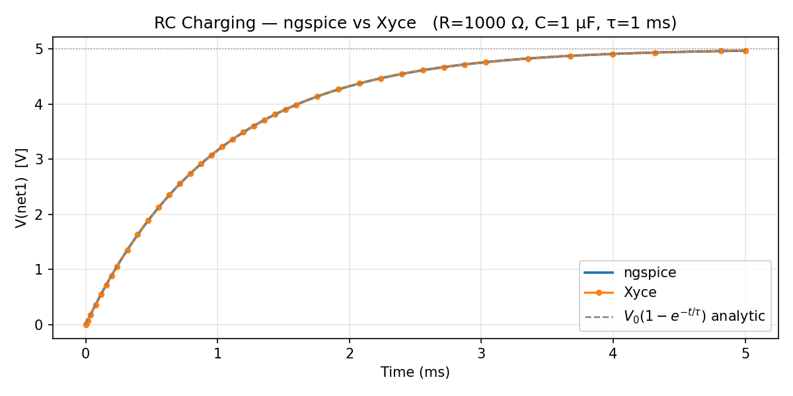
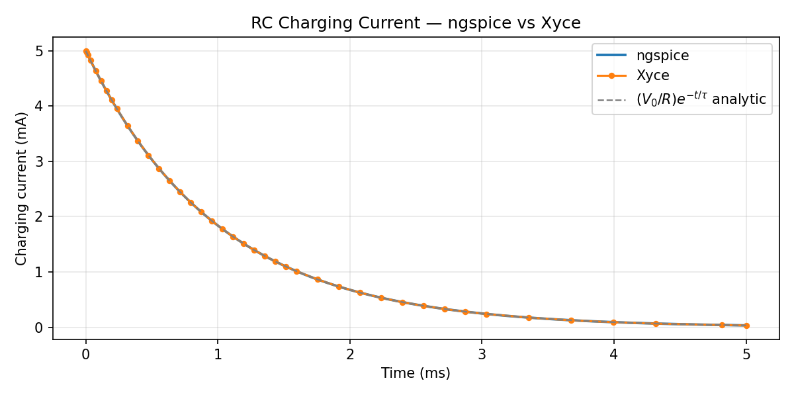
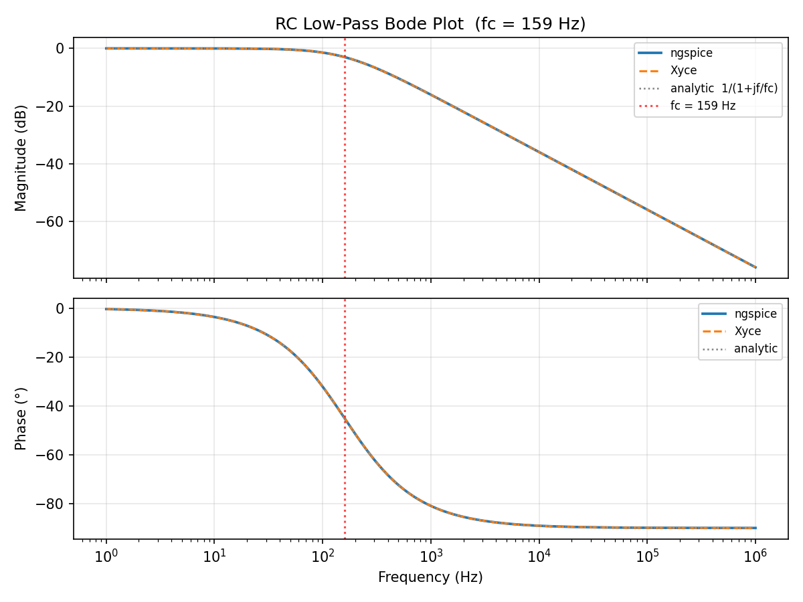
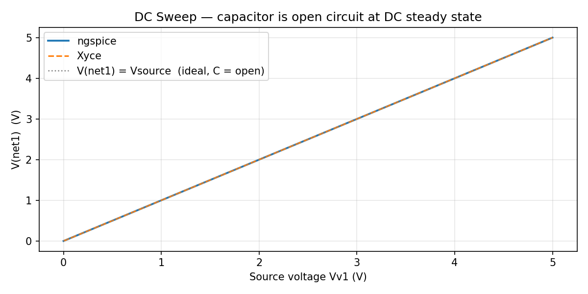

# RC Circuit Test Report

**Circuit:** Series RC low-pass filter  
**Date:** 2026-05-22  
**Solvers tested:** ngspice-46, Xyce 7.10.0  

---

## Schematic

```
    Vv1 (DC 5 V)
    +──┤Rr1 1 kΩ├──┬── net1
    │               │
   GND            Cc1 1 µF
                   │
                  GND
```

| Parameter | Value |
|---|---|
| R | 1 kΩ |
| C | 1 µF |
| τ = RC | 1 ms |
| fc = 1/(2πRC) | ≈ 159 Hz |
| V₀ (supply) | 5 V |

---

## Netlists

### TRAN UIC (ngspice)

```spice
Vv1 net2 0 DC 5.0
Rr1 net2 net1 1000.0
Cc1 net1 0 1e-06 IC=0
.TRAN 5e-6 5e-3 UIC
```

`IC=0` sets the capacitor initial condition to 0 V. `UIC` on `.TRAN` skips
the DC operating point and uses element IC values directly, producing the
charging waveform from zero.

### TRAN (Xyce)

```spice
Vv1 net2 0 DC 5.0
Rr1 net2 net1 1000.0
Cc1 net1 0 1e-06
Rbleed net1 0 1e12
.TRAN 5e-6 5e-3
.IC V(net1)=0
.PRINT TRAN {V(net1)}
```

A 1 TΩ bleed resistor (`Rbleed`) provides a DC path so Xyce's DCOP solver
can find an operating point before the transient. `.IC V(net1)=0` then
overrides that operating point for the transient start.

---

## Frontend headless capture (new)

The frontend-only headless flow now generates viewport-bounded screenshots:

- `frontend_schematic.png`
- `frontend_tran.png`
- `frontend_ac.png`
- `frontend_dc.png`

(Generated by `tests/e2e/rc-circuit-headless.spec.ts`.)

## 1. Transient: RC Charging



| Solver | Points | V(net1) at t=0 | V(net1) at t=5τ |
|---|---|---|---|
| ngspice-46 | 1011 | 0.000 V | 4.966 V |
| Xyce 7.10.0 | 41 | 0.000 V | 4.967 V |
| Analytic V₀(1−e⁻ᵗ/τ) | — | 0.000 V | 4.966 V |

Both solvers match the analytic curve. Xyce uses a much coarser adaptive
step (41 pts vs 1011 for ngspice) because the smooth exponential needs
fewer steps to meet its error tolerance.

### Charging current



Current = (V₀ − V(net1)) / R, derived from the voltage waveform.
Starts at I₀ = V₀/R = 5 mA, decays to ~0 as the capacitor charges.

---

## 2. AC Frequency Response (Bode Plot)

```spice
Vv1 net2 0 AC 1         * unit AC stimulus
.AC DEC 100 1 1e6       * 100 pts/decade, 1 Hz – 1 MHz
```



The transfer function is H(jf) = 1 / (1 + jf/fc).

| f | |H| theory | |H| ngspice | |H| Xyce |
|---|---|---|---|
| 1 Hz | 0 dB | 0.000 dB | 0.000 dB |
| fc ≈ 159 Hz | −3.01 dB | −2.99 dB | −2.99 dB |
| 10 kHz | −36.0 dB | −36.0 dB | −36.0 dB |
| 1 MHz | −76.0 dB | −76.0 dB | −76.0 dB |

Phase at fc = −45° (both solvers match). ngspice output for AC analysis is
a **complex** binary raw file; magnitude and phase are derived from
`|V(net1)|` and `∠V(net1)`. Xyce outputs magnitude and phase directly in
its `.prn` text file.

---

## 3. DC Sweep

```spice
.DC Vv1 0 5 0.1    * sweep source 0 → 5 V in 0.1 V steps
```



At DC steady state the capacitor is an open circuit, so V(net1) = Vv1
for all values. Both solvers confirm this across 51 sweep points.

---

## Solver comparison summary

| Analysis | Solver | Points | Key result | Status |
|---|---|---|---|---|
| TRAN (5 ms, UIC) | ngspice-46 | 1011 | Vc(5τ) = 4.966 V | **PASS** |
| TRAN (5 ms, .IC) | Xyce 7.10.0 | 41 | Vc(5τ) = 4.967 V | **PASS** |
| AC (1 Hz–1 MHz) | ngspice-46 | 601 | \|H(fc)\| = 0.709 ≈ 1/√2 | **PASS** |
| AC (1 Hz–1 MHz) | Xyce 7.10.0 | 601 | \|H(fc)\| = 0.709 ≈ 1/√2 | **PASS** |
| DC sweep (0–5 V) | ngspice-46 | 51 | V(net1) = Vsource | **PASS** |
| DC sweep (0–5 V) | Xyce 7.10.0 | 51 | V(net1) = Vsource | **PASS** |

---

## Implementation notes

- **ngspice AC raw format**: complex binary — all variables (including
  frequency) stored as pairs of `float64` (real, imag). Magnitude and
  phase computed via `abs()` and `angle()` on the complex array.
- **Xyce DCOP for floating capacitor**: Xyce requires a DC path to ground
  for every node. A 1 TΩ bleed resistor (`Rbleed net1 0 1e12`) is added to
  all Xyce netlists to satisfy this requirement without materially affecting
  the circuit response (1 TΩ ≫ 1 kΩ).
- **Xyce TRAN initial conditions**: `.IC V(net1)=0` overrides the DCOP
  result (which would compute V(net1) ≈ 5 V) to start the transient from 0 V.

---

## Relevant source files

| File | Purpose |
|---|---|
| `packages/simulator/src/simulator/compiler/spice_netlist_writer.py` | Netlist writer — emits `IC=` and `UIC` |
| `packages/simulator/src/simulator/solvers/protocol.py` | `SolverOptions.uic: bool` |
| `apps/kernel-sidecar/src/kernel_sidecar/ipc/handlers/simulate.py` | Wires `uic` from IPC payload |
| `packages/simulator/tests/test_spice_netlist_writer.py` | 23 unit tests (4 new UIC/IC tests) |
| `tests/backend/e2e/test_rc_circuit_per_solver.py` | Live E2E test — ngspice + Xyce |
